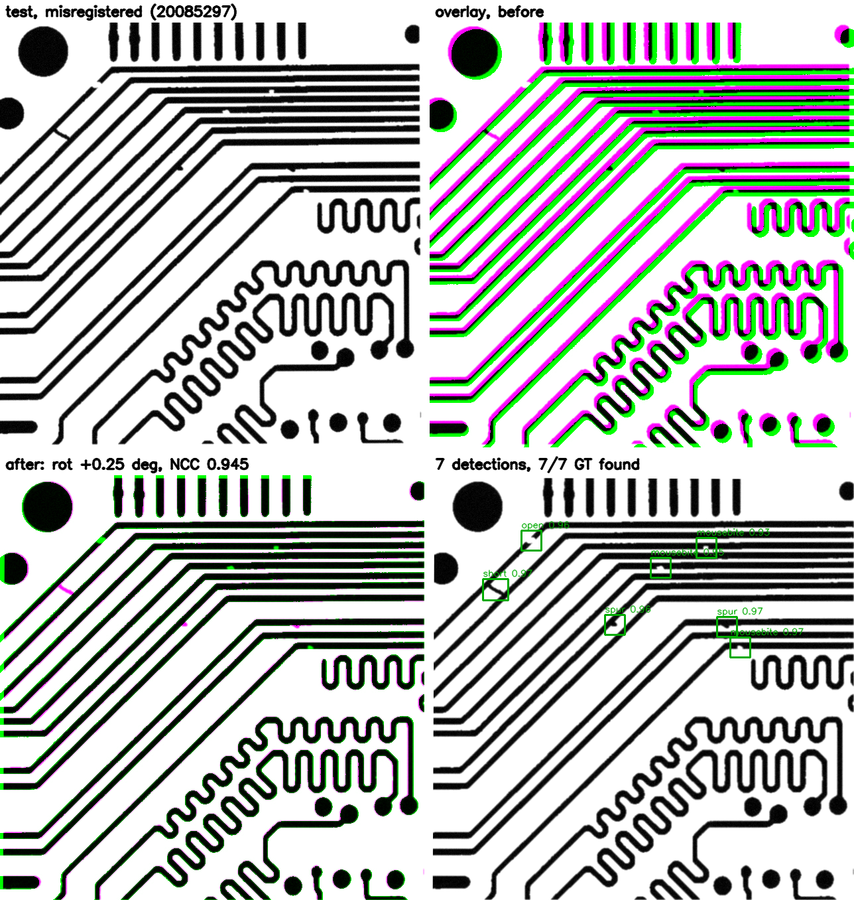
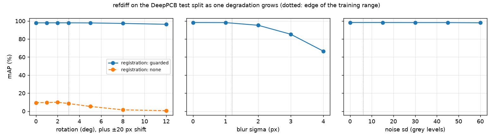

# refdiff: find PCB defects by comparing to a reference


Automated optical inspection usually has something a generic object detector does not: a picture of what
the part *should* look like. That is a golden image (die-to-die) or the design database (die-to-database).
refdiff uses it. It registers the test image to the reference with sub-pixel accuracy, takes a signed
difference, and classifies only the regions that changed. It runs on [DeepPCB](https://github.com/tangsanli5201/DeepPCB):
1,500 template/test pairs of 640×640 PCB crops with 6 defect types. It is then tested, without
retraining, on a second dataset of colour photos.

**What the experiments say** (numbers under Results; the reasoning and dead ends are in
[docs/DESIGN.md](docs/DESIGN.md)):

- **The reference image is what matters.**
  - refdiff beats a YOLOv8 that sees only the test image.
  - A YOLOv8 given the template and the diff as extra input channels ties with refdiff on DeepPCB.
  - Inside refdiff, a classifier that never sees the template barely loses anything, because the diff
    has already found the defects.
- **The explicit pipeline is what transfers.** On a second dataset (PKU, colour photos, never trained
  on):
  - The template-blind YOLO collapses.
  - The template-aware YOLO keeps working.
  - refdiff does clearly better than either.
- **Registration is what makes either one usable on real misalignment.** Without it, rotated images
  are almost all missed.
- **The errors that remain are mostly the diff grouping pixels wrongly, not missing defects.** One defect
  splits into two boxes, or a crack is found only in part.



*One test pair, warped by a known rotation and shift and then blurred and noised. Top: before registration
(template magenta, test green). Bottom: after registration, then detections. `make demo` regenerates it.*

## Pipeline

1. **Register** (`refdiff/register.py`). Coarse rotation comes from Fourier–Mellin: phase correlation of
   the log-polar FFT magnitudes, which ignores translation. Translation then comes from phase correlation,
   and ECC refines a Euclidean warp on a 3-level pyramid. A **guard** runs identity, ECC, phase+ECC and
   FM+ECC, drops warps that leave less than half the frame covered, and keeps the one with the highest NCC
   on the overlap they all share. Periodic pad arrays can pull the Fourier estimate one pitch off. A
   near-blank crop gives it nothing to lock onto, and in that case the guard **flags the pair for review**
   (NCC < 0.5) rather than returning a wrong warp with confidence. Most of the time goes to ECC, so the
   three ECC chains share one pyramid and run the coarse levels separately. Chains that have converged to
   the same warp share a single full-resolution pass. The Fourier estimates stay at full resolution: at
   half resolution, the log-polar spectrum is too coarse to pin the rotation on large warps.
2. **Diff** (`refdiff/candidates.py`). A tolerant signed XOR: a pixel counts as *extra copper* if the test
   has copper there and the template has none within `tol` px, and as *missing copper* the other way round.
   Morphological opening, merging of blobs of the same sign, and boxes sized to the GT box style follow.
   The sign alone nearly splits the classes in two (short / spur / copper add copper, open / mousebite /
   pin-hole remove it; counts under Results).
3. **Classify** (`refdiff/model.py`). A small CNN on 64×64 crops with three channels (test, template,
   signed diff), plus the sign and log size, outputs the 6 classes + background. It trains on trainval
   candidates from both the as-shipped pairs and pairs warped and registered back, so it sees real
   registration residue. It is exported to ONNX (`models/candnet.onnx`, 2.4 MB) so the CI gate and the
   demo run without torch.

Baselines, all trained on the same 900 / 100 split of trainval and scored by the same scorer:

- **YOLOv8n, template-blind** (`scripts/yolo_baseline.py`): the test image only.
- **YOLOv8n with the reference** (`--input ttd`): a 3-channel image of the registered test, the template
  and the signed diff. It gets the reference, but none of refdiff's candidate stage.
- **Shape-only** (`scripts/shape_baseline.py`): refdiff's own candidates, classified from their geometry
  alone by gradient-boosted trees, with no CNN.

`refdiff/metrics.py` re-implements the DeepPCB rule (a hit is IoU > 0.33 with a same-class GT box; VOC
all-point AP per class), because the official script is Python 2 and needs the `Polygon` package.

## Results

Every number below is written by a script into `results/*.json` and rendered into this README by
`make table`. Nothing is typed in by hand.

<!-- results:begin -->
### Detection, DeepPCB test split (500 images, IoU > 0.33, score ≥ 0.5)

| method | sees template | mAP | 95% CI | F1 | precision | recall |
|---|---|---|---|---|---|---|
| YOLOv8n | no | 96.8 | n/a | 94.0 | 92.9 | 95.2 |
| YOLOv8s | no | 97.1 | n/a | 94.7 | 94.9 | 94.6 |
| YOLOv8n on test + template + diff | yes | 98.9 | n/a | 97.8 | 98.2 | 97.5 |
| refdiff candidates, trees on shape only (no CNN) | yes | 26.5 | n/a | 40.9 | 49.4 | 34.9 |
| **refdiff** (registration → diff → classifier) | yes | **98.3** | [97.7, 98.8] | **98.2** | 98.7 | 97.7 |

refdiff over 3 classifier seeds: mAP 98.1–98.3. End to end 146 ms/image on CPU (registration 125, diff + crops 14, ONNX classifier 7).

Paired bootstrap over the same 500 images, refdiff minus each baseline:

| refdiff − | mAP points | 95% CI | F1 points | 95% CI |
|---|---|---|---|---|
| YOLOv8n | 1.5 | [0.7, 2.4] | 4.2 | [3.1, 5.3] |
| YOLOv8s | 1.2 | [0.4, 2.1] | 3.5 | [2.6, 4.3] |
| YOLOv8n on test + template + diff | -0.6 | [-1.1, 0.0] | 0.4 | [-0.1, 0.8] |
| refdiff candidates, trees on shape only (no CNN) | 71.8 | [69.6, 73.5] | 57.3 | [55.4, 59.2] |

Diff sign vs class family on matched test candidates: short / spur / copper came out as extra copper 1422 of 1427 times; open / mousebite / pin-hole as missing copper 1699 of 1705.

Per class AP:

| class | open | short | mousebite | spur | copper | pin-hole |
|---|---|---|---|---|---|---|
| YOLOv8n | 97.6 | 92.1 | 97.5 | 96.9 | 98.2 | 98.2 |
| YOLOv8s | 98.0 | 93.8 | 97.4 | 96.6 | 98.5 | 98.3 |
| YOLOv8n on test + template + diff | 98.7 | 98.2 | 98.5 | 98.5 | 99.3 | 100.0 |
| refdiff candidates, trees on shape only (no CNN) | 22.9 | 27.2 | 19.1 | 35.7 | 40.3 | 13.6 |
| refdiff | 98.0 | 96.5 | 97.7 | 98.6 | 99.7 | 99.2 |

### Does registration matter? (same classifier, same scorer)

| scenario | registration | candidate recall | mAP | 95% CI | F1 |
|---|---|---|---|---|---|
| as-shipped pairs | guarded | 98.9 | 98.3 | [97.7, 98.8] | 98.2 |
| as-shipped pairs | none | 97.9 | 97.1 | [96.3, 97.8] | 97.3 |
| test warped ±3°, ±20 px, blur + noise | guarded | 98.6 | 97.6 | [97.0, 98.3] | 97.8 |
| test warped ±3°, ±20 px, blur + noise | none | 29.4 | 10.8 | [9.4, 13.0] | 20.2 |

On the as-shipped pairs, registration on − off: mAP 1.2 points, paired 95% CI [0.6, 1.9].

### What each part of the classifier buys (seed 0, as-shipped test pairs)

Same network and candidates, with one input or training source taken away (`scripts/ablations.py`).

| variant | mAP | F1 | full − variant, mAP points | 95% CI |
|---|---|---|---|---|
| full model (as shipped) | 98.3 | 98.2 | n/a | n/a |
| no template channel | 98.3 | 98.1 | 0.0 | [-0.2, 0.3] |
| no signed-diff channel | 98.2 | 98.0 | 0.1 | [-0.1, 0.3] |
| test crop only (template-blind classifier) | 97.7 | 97.3 | 0.6 | [0.2, 1.0] |
| no side features | 98.1 | 97.7 | 0.2 | [-0.0, 0.4] |
| no warped pairs in training | 97.5 | 97.3 | 0.8 | [0.4, 1.2] |

### Where it breaks (`scripts/robustness.py`)



| degradation | level | mAP, registered | mAP, no registration |
|---|---|---|---|
| rotation | 0° | 98.0 | 9.4 |
| rotation | 1° | 98.0 | 9.6 |
| rotation | 2° | 98.0 | 9.9 |
| rotation | 3° | 98.0 | 8.5 |
| rotation | 5° | 97.9 | 5.3 |
| rotation | 8° | 97.3 | 1.5 |
| rotation | 12° | 96.4 | 0.6 |
| blur | 0 px σ | 98.3 | n/a |
| blur | 1 px σ | 98.2 | n/a |
| blur | 2 px σ | 95.3 | n/a |
| blur | 3 px σ | 85.3 | n/a |
| blur | 4 px σ | 66.6 | n/a |
| noise | 0 sd | 98.3 | n/a |
| noise | 15 sd | 98.3 | n/a |
| noise | 30 sd | 98.2 | n/a |
| noise | 45 sd | 98.2 | n/a |
| noise | 60 sd | 98.0 | n/a |

### Diff-stage sensitivity (`scripts/diff_sweep.py`, shipped classifier, defaults in bold)

| XOR tolerance (px) | min blob area (px) | candidate recall | candidates / image | mAP |
|---|---|---|---|---|
| 0 | 6 | 99.2 | 12.3 | 98.5 |
| **0** | **12** | 98.9 | 11.3 | 98.3 |
| 0 | 24 | 97.3 | 9.6 | 96.9 |
| 1 | 6 | 93.3 | 7.4 | 92.3 |
| 1 | 12 | 90.7 | 7.0 | 89.9 |
| 1 | 24 | 83.4 | 6.1 | 83.6 |
| 2 | 6 | 68.9 | 4.9 | 67.1 |
| 2 | 12 | 65.6 | 4.6 | 64.7 |
| 2 | 24 | 57.6 | 3.9 | 58.2 |

### Where the errors are (score ≥ 0.5; 3140 labelled defects)

Every miss and false alarm, tagged with a cause by `scripts/failure_analysis.py`; its count links to a gallery (template | test | signed diff after registration; label green, detection red).

| Missed defects | refdiff | YOLOv8n |
|---|---|---|
| low score | [32](docs/failures/refdiff_missed_low-score.jpg) | [84](docs/failures/yolov8n_missed_low-score.jpg) |
| diff empty | [15](docs/failures/refdiff_missed_diff-empty.jpg) | n/a |
| diff box off | [14](docs/failures/refdiff_missed_diff-box-off.jpg) | n/a |
| box off | [6](docs/failures/refdiff_missed_box-off.jpg) | [4](docs/failures/yolov8n_missed_box-off.jpg) |
| wrong class | [5](docs/failures/refdiff_missed_wrong-class.jpg) | [19](docs/failures/yolov8n_missed_wrong-class.jpg) |
| not detected | n/a | [41](docs/failures/yolov8n_missed_not-detected.jpg) |
| **total** | **72** | **148** |

| False alarms | refdiff | YOLOv8n |
|---|---|---|
| duplicate | [15](docs/failures/refdiff_false-alarm_duplicate.jpg) | [9](docs/failures/yolov8n_false-alarm_duplicate.jpg) |
| fragment | [9](docs/failures/refdiff_false-alarm_fragment.jpg) | [8](docs/failures/yolov8n_false-alarm_fragment.jpg) |
| burned-in label | [7](docs/failures/refdiff_false-alarm_burned-in-label.jpg) | n/a |
| wrong class | [6](docs/failures/refdiff_false-alarm_wrong-class.jpg) | [31](docs/failures/yolov8n_false-alarm_wrong-class.jpg) |
| no defect | [4](docs/failures/refdiff_false-alarm_no-defect.jpg) | [181](docs/failures/yolov8n_false-alarm_no-defect.jpg) |
| box off | [1](docs/failures/refdiff_false-alarm_box-off.jpg) | [6](docs/failures/yolov8n_false-alarm_box-off.jpg) |
| **total** | **42** | **235** |

Errors by board. DeepPCB comes from a few boards, and the official split leaves some out of training entirely:

| board | test images | train images | refdiff missed / false alarms | YOLOv8n missed / false alarms |
|---|---|---|---|---|
| 00041 | 21 | 200 | 0 / 0 | 2 / 1 |
| 12000 | 14 | 0 | 0 / 0 | 5 / 66 |
| 12100 | 146 | 0 | 5 / 2 | 17 / 16 |
| 12300 | 98 | 0 | 9 / 3 | 7 / 27 |
| 13000 | 18 | 198 | 10 / 2 | 3 / 0 |
| 20085 | 34 | 291 | 6 / 0 | 9 / 4 |
| 44000 | 50 | 50 | 22 / 18 | 55 / 31 |
| 50600 | 29 | 50 | 4 / 1 | 2 / 53 |
| 77000 | 7 | 100 | 0 / 0 | 0 / 1 |
| 90100 | 74 | 0 | 16 / 16 | 48 / 36 |
| 92000 | 9 | 111 | 0 / 0 | 0 / 0 |

| | seen boards mAP / F1 | unseen boards mAP / F1 |
|---|---|---|
| refdiff (168 / 332 images) | 97.7 / 97.1 | 98.7 / 98.7 |
| YOLOv8n (168 / 332 images) | 96.1 / 93.0 | 97.2 / 94.7 |

Images (of all 1,500 pairs) with the annotations drawn into the pixels: 44000020.

### Registration accuracy (500 test pairs, known warp, corner error in px)

| method | warp only: median | p95 | max | warp + optics: median | p95 | max | ms |
|---|---|---|---|---|---|---|---|
| none | 19.983 | 26.87 | 30.3 | 19.866 | 26.99 | 31.1 | 0 |
| orb | 0.225 | 1.11 | 646.2 | 0.484 | 21.14 | 994.0 | 13 |
| sift | 0.168 | 494.44 | 542.3 | 0.275 | 474.78 | 3156.8 | 62 |
| phase | 12.622 | 23.69 | 310.2 | 11.823 | 23.57 | 341.2 | 8 |
| fm | 0.165 | 0.69 | 23.1 | 0.183 | 0.70 | 310.2 | 45 |
| ecc | 0.066 | 0.33 | 74.0 | 0.073 | 0.37 | 54.8 | 27 |
| phase+ecc | 0.066 | 0.34 | 308.0 | 0.073 | 0.38 | 11829.7 | 35 |
| fm+ecc | 0.066 | 0.31 | 2.7 | 0.072 | 0.34 | 310.2 | 70 |
| guarded | 0.066 | 0.31 | 2.7 | 0.072 | 0.34 | 2.6 | 108 |

Guarded, warp + optics: 0 of 500 pairs flagged for review (NCC < 0.5); worst error among the rest 2.58 px. On the as-shipped pairs, 153 of 500 move by more than 1 px when registered (median 0.62, p95 3.2 px), and the off-defect pixel mismatch drops from 1.96% to 1.54%.

### A second dataset, no retraining: PKU synthetic PCB defects (693 images, 2953 defects)

The DeepPCB-trained pipeline with every parameter unchanged, on binarized PKU colour photos scaled by 0.487 (`scripts/pku_transfer.py`). *Any class* counts a defect box at IoU > 0.33 whatever its class.

| images | registration | mAP | F1 | any-class mAP | any-class recall | any-class precision |
|---|---|---|---|---|---|---|
| as shipped (aligned to ~1 px) | guarded | 64.0 | 67.8 | 84.6 | 72.4 | 87.5 |
| as shipped (aligned to ~1 px) | none | 60.4 | 64.0 | 72.9 | 72.4 | 69.1 |
| PKU's rotated copies | guarded | 51.2 | 54.2 | 63.0 | 73.0 | 47.9 |
| PKU's rotated copies | none | 0.9 | 4.6 | 0.2 | 16.8 | 0.3 |
| as shipped, **YOLOv8n template-blind** (DeepPCB-trained, 640 px tiles) | n/a | 8.0 | 2.1 | 0.8 | 30.1 | 0.9 |
| as shipped, **YOLOv8n on test + template + diff** (DeepPCB-trained, 640 px tiles) | guarded | 50.3 | 53.7 | 70.9 | 76.2 | 60.9 |

Per PKU class, as-shipped images, refdiff: recall of any-class boxes, and AP under the mapped DeepPCB class:

| PKU class | open_circuit | short | mouse_bite | spur | spurious_copper | missing_hole |
|---|---|---|---|---|---|---|
| any-class recall | 88.4 | 90.0 | 86.8 | 44.1 | 58.4 | 67.4 |
| AP as mapped class | 80.1 | 82.9 | 75.0 | 55.0 | 58.5 | 32.3 |

Scale sensitivity (as-shipped images): ×0.7: mAP 44.6, any-class 60.4; ×1.0: mAP 64.0, any-class 84.6; ×1.4: mAP 61.2, any-class 74.3.

Registration under known warps (±10°, ±40 px): median 0.012 px, p95 0.035, max 22.90; 3 of 693 pairs off by more than 2 px, 0 flagged for review.

### Die-to-database stretch (200 random GDSII layouts, held-out seeds)

| | registration error median / p95 / max (px) | defect recall | precision | candidates / die |
|---|---|---|---|---|
| no registration | 13.66 / 19.65 / 21.33 | 19.5 | 0.7 | 104.9 |
| guarded registration | 0.071 / 0.170 / 0.408 | 92.2 | 86.1 | 4.3 |

<!-- results:end -->

### Notes on reading these

- **DeepPCB pairs are only roughly aligned.** The dataset aligned them by integer template matching.
  Registering them moves a third of the pairs by more than a pixel, and the worst by about 10 px. That
  is why registration accuracy is scored on *synthetic* warps with known ground truth, not on the
  as-shipped pairs. The synthetic image is the template with the real defect patches pasted in, warped
  by ±3° and ±20 px, then optionally blurred, gain-shifted and noised (`refdiff/synth.py`).
- **Corner error overstates some misses.** The 2–3 px cases among the confident pairs are boards made of
  long parallel traces. They have the same NCC as the true warp, because nothing pins the shift *along*
  a trace (the aperture problem), and that shift leaves the diff unchanged.
- **What refdiff still gets wrong** (the error tables and galleries above):
  - Most of its false alarms are real defects counted more than once. One defect breaks into two diff
    blobs (*duplicate*), or a long crack is found only in part (*fragment*). That is a grouping problem in
    the diff stage, not the classifier inventing defects. Only a handful of false alarms land where
    nothing is labelled.
  - Its misses split roughly evenly between two stages. Sometimes the classifier rejects a region the
    diff did find (*low score*: thin slivers and dotted residue that look like misregistration). Other
    times the diff stage misses:
    - *diff empty*: one-to-two-pixel mousebites and pin holes that the tolerance and opening erase.
    - *diff box off*: shorts on boards of long parallel traces, where registration residue runs along
      the traces (the aperture problem above) and the defect merges into it.
- **What YOLO gets wrong that refdiff does not.** Most of YOLO's false alarms fire where nothing is
  labelled, and they cluster on two boards. One of them (50600, white gaps cut into solid copper) was in
  its training set. YOLO calls the intended gaps "open", because without a template nothing tells it a
  gap is meant to be there.
- **Board novelty does not explain the gap.** Four of the test boards never appear in trainval. I
  expected the template-blind model to suffer most on them, but both methods score *higher* on the
  unseen boards, and the gap between them is similar on seen and unseen boards.
- **One test image has its labels drawn into the pixels** (boxes and class names in grey). The diff
  reports the text as defects. A scan of all 1,500 pairs (`burned_in` in `scripts/failure_analysis.py`)
  finds no other image like it. It stays in the scores, because the official split includes it.
- **Template-aware YOLO vs refdiff.** On DeepPCB they tie, and the paired interval on the gap crosses
  zero. On PKU, refdiff stays well ahead without retraining. The template-blind YOLO marks every pad
  ring and patch of texture in the binarized photos, things the template cancels for refdiff. The PKU
  numbers are point estimates: that script does not keep per-image detections, so they have no
  bootstrap interval.
- **The ablations agree with the baselines.** The classifier needs the reference in *some* form, but
  either the template channel or the diff channel is enough: each is redundant given the other.
  Training on warped-and-registered pairs, so the classifier has seen registration residue, matters
  more than any input channel.
- **Blur, not rotation or noise, is the weak axis.**
  - Registration absorbs rotation well past the training range.
  - Binarization absorbs noise.
  - Blur erases exactly the one-to-two-pixel defects that the error analysis already finds hardest
    (*diff empty*).
- **The diff has no slack in its tolerance, and one parameter I chose not to change.**
  - A single pixel of XOR tolerance already erases enough small defects to cost several points of
    recall (diff-stage table).
  - A smaller minimum blob area scores a little higher *on test*. The default was fitted on trainval,
    and moving it after looking at test would make the headline number optimistic, so it stays.
- **Keypoint registration does not work on DeepPCB.** SIFT and ORB with RANSAC lock onto the wrong
  copies of repeated pads and vias. The median looks fine, but the tail is hundreds of pixels. On
  a PKU rotated image I checked by hand, where the board is less periodic, SIFT agreed with the guard (one
  image, not a measured rate).
- **The paper's 98.6 mAP** comes from the authors' own model and the ICDAR-derived script. The scorer
  here applies the same matching rule, but small differences in AP interpolation mean the numbers are
  close rather than identical.

## Die-to-database (stretch)

`refdiff/layout.py` builds a random Manhattan layout (traces, pads, drilled vias) with **gdstk**, writes
it as GDSII (`examples/die.gds`), and rasterizes it with anti-aliasing as the database image. The
"optical" image is the same layout after ±1 px etch bias, a Gaussian PSF (σ 1–2 px), a known rotation and
shift, an illumination gradient and sensor noise, with injected shorts, opens, spurious copper and pin
holes. Registration has to put the optical image back onto the database, and the signed diff alone has to
find the defects. `scripts/die2db.py` reports on layout seeds that the diff parameters were never tuned on.

## Reproduce

```bash
make env            # uv venv, Python 3.11, pinned torch / onnxruntime
make data           # clone DeepPCB (MIT) to the path in config/paths.yaml
make results        # candidates → 3 classifier seeds → ONNX → registration / detection / die2db evals → error analysis → tables
make setup-yolo yolo yolo-ttd yolo-s shape   # baselines (ultralytics is AGPL-3.0, optional)
make ablations robustness failures            # what each part buys, where it breaks, every error by cause
make pku-data pku                             # second dataset, no retraining
make compare table  # paired bootstraps against every baseline, then the README tables
make space          # the interactive demo as a Hugging Face Space folder (build/space; not uploaded)
make gate           # the CI gate: registration + full test-split detection with the committed ONNX model
make test lint demo
```

CI ([`.github/workflows/ci.yml`](.github/workflows/ci.yml)) runs the unit tests, then clones DeepPCB and
runs `scripts/gate.py`. The build fails if guarded registration error or test-split mAP / F1 cross the
limits in [`eval/gate.json`](eval/gate.json).

## Layout

```
refdiff/   data.py  register.py  synth.py  candidates.py  pipeline.py  model.py  classify.py  metrics.py  layout.py
scripts/   eval_registration.py  build_candidates.py  train_classifier.py  export_onnx.py  eval_detection.py
           yolo_baseline.py  compare.py  die2db.py  failure_analysis.py  gate.py  demo.py  results_table.py
results/   *.json written by the scripts above (+ failures.csv, every error with its cause)
docs/failures/  one gallery per method × error kind × cause
models/    candnet.onnx (seed 0)
```

## Licenses

Code: [PolyForm Noncommercial 1.0.0](LICENSE). Free to use, change and share for personal, research, teaching and other non-commercial purposes; commercial use needs written permission. DeepPCB: MIT (tangsanli5201/DeepPCB), not redistributed here. The YOLO baseline uses
ultralytics (AGPL-3.0) as an optional extra. It is installed separately and nothing in `refdiff/`
imports it.
